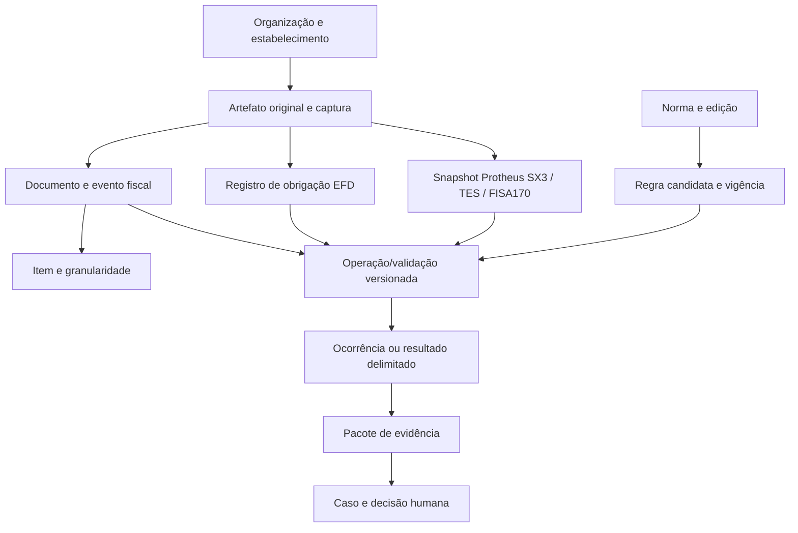

# Arquitetura lógica, modelo fiscal temporal e contratos fundamentais da V1

**Natureza:** especificação de desenho pré-implementação, não DDL, não software, não aprovação. O estado do Supabase/Protheus não é inferido a partir destas entidades. Compatibilidade do dicionário SX3 depende de snapshot autorizado e release TOTVS; modelagem relacional utiliza 1FN/2FN/3FN quando pertinente; OMG MOF é opcional e separado de MOC fiscal.

## 1. Cinco ledgers lógicos que não podem ser confundidos

| Ledger | Unidade canônica | Mínimos identificadores e versão | Conteúdo/exclusão |
|---|---|---|---|
| L1 — Fatos | `TaxFact`, `FiscalDocument`, `FiscalItem`, `ObligationRecord` | sourceArtifactId, org/estab, docKey, eventId, competência, eventAt, validAt, recordVersion | Representa fato recebido; **nunca** reescrito por recálculo |
| L2 — Normas e parâmetros | `NormativeSource`, `RuleVersion`, `ERPConfigVersion`, `ClassificationVersion` | issuer, jurisdiction, edition, publishedAt, validFrom/To, recordedAt, ruleHash, approvalRef | Ato jurídico ≠ interpretação da regra ≠ configuração FISA170 |
| L3 — Execuções | `ValidatorRun`, `JoinRun`, `RuleEvaluation`, `PeriodComparison` | runId, codeCommit, contractVersion, sourceRefs, ruleVersion, parameters, inputDigest | Cálculo/reperformance técnica; **não** altera o fato original |
| L4 — Evidências | `SourceArtifact`, `EvidenceObject`, `LineageEdge`, `WorkpaperVersion` | sha256 bytes, contentType, captureAt, storageRef, classification, retention, evidenceId | WORM/imutabilidade lógica; logs não substituem bytes originais |
| L5 — Ações humanas | `InvestigationCase`, `CaseAction`, `ApprovalDecision`, `RiskAcceptance` | actorId, role, org, timestamp, before/after, decisionRef, reason, reviewer | Decisão/parecer/aceite em identidade real; motor não assina |

**“Ledger”** é uma separação de responsabilidades e logs auditáveis, não cinco SGBDs nem uma exigência de blockchain. Na V1 deve haver uma visão de linhagem que parte de um achado e retorna a arquivo, campo, contexto, regra, método, versão e responsável.

## 2. Modelo conceitual mínimo

**Granularidade:** documento, item, evento, obrigação, escrituração, apuração e pagamento são objetos distintos com identificadores/cortes próprios. Não exigir um único documento XML por fato econômico, pois há eventos, versões, cancelamentos, retificações e representações da mesma operação. O vínculo é explícito, possivelmente 1:N e N:M, com estado `MATCH_CANDIDATE` quando faltar prova.

## 3. Contratos de origem no núcleo V1

- **Fonte DF-e:** `NFE_55_XML` com XML original, namespace, versão de leiaute/XSD, chave de 44 dígitos/DV, ambiente, situação e eventos se houver; documentos sintéticos e sem assinatura real não são classificados como NF-e autorizada.
- **Fonte SPED:** `EFD_ICMS_IPI` com `COD_VER`, período, perfil, blocos/registros **declaradamente suportados** e linhas não suportadas tratadas como `OUT_OF_SCOPE/BLOCKED` conforme o teste. Guia versão 3.2.4 não equivale a versão do PVA 6.2.0; ambos entram no catálogo por identificadores distintos.
- **Fonte ERP:** `PROTHEUS_SNAPSHOT` de SX2/SX3/SIX, TES/SF4 e dados fiscais derivados, **somente via arquivo sintético ou snapshot expressamente autorizado**. FISA170 híbrido requer mapeamento por tributo, empresa, filial, parâmetros e release. Sem release e dicionário confirmados: `HOLD_SOURCE_CONTRACT`.
- **Fonte geral:** CSV/XLSX, arquivo texto ou tabela importada como dataset analítico, sempre com schema, proveniência, classificação e controles de limite; importar arquivo não valida uma obrigação fiscal.

Entradas **não incluídas na V1 operacional**: CT-e, NFC-e, NFS-e nacional, NFCom, NF3e, BP-e, MDF-e, EFD-Contribuições, ECD, ECF, Reinf, eSocial, DCTFWeb/MIT, e-CAC, DARF/boletos/retificação; porém o modelo de fonte admite novos tipos sem quebrar a V1. Essas fontes ficam catalogadas em backlog com normas próprias por período, nunca declaradas como implementadas.

## 4. Ingestão, idempotência e completude

Fluxo: autorização → contrato de fonte → captura original → hash SHA-256 dos **bytes reais** → identificação lógica → schema/XSD ou leiaute declarado → quarentena e rejeitos → normalização tipada → publicação do manifesto.

- `artifact_sha256` identifica conteúdo; `ingest_event_id` identifica a captura. O mesmo documento vindo de dois canais cria **duas proveniências, um fato canônico apenas se deduplicação forte for comprovada**.
- Idempotência de operação deriva de `org + source_contract + semantic_input_hash + module_version + parameter_hash`; timestamps e usuário de execução não entram no digest semântico.
- `recordsRead = accepted + rejected` onde o contrato distinguir registros; separar linhas físicas/cabeçalhos/rodapés de unidades fiscais.
- Falta de arquivo, corte de lote, XSD/guia incongruente ou leitura parcial = `BLOCKED/ERROR`; **não** dataset vazio válido.
- Arquivos assinados têm verificação de assinatura/certificado e cadeia quando aplicável e tecnicamente disponível; a mera presença de tag de assinatura não comprova autenticidade.
- Não aceitar XML com DTD/ENTITY, zip bomb, path traversal, payload sem limite ou acesso cross-tenant.

## 5. Contratos de dados numéricos e mapeamento

- Valores fiscais e bases: DECIMAL exato com escala; não computar valores monetários em double/float binário sem demonstração de erro tolerável.
- Chave NF-e de 44 dígitos, CNPJ, NCM, CFOP, CST, TES e códigos ERP: string para preservar zeros, dígito e semântica; não cast implícito.
- `null`, `missing`, `zero`, `not_applicable`, `unknown` e `invalid` são estados de origem/qualidade distintos; não converter silenciosamente.
- `organization`, `establishment`, `tax_regime`, `operation_type`, `jurisdiction`, `valid_at`, `erp_release` integram os contratos onde pertinente.
- Dicionário mestre define campo físico e lógico com alias, tipo, tamanho, escala, domínio de valores, origem e versão. SF4/TES versus FISA170 exigem precedence com fonte/edição; nunca hard-coded sem release validado.

## 6. Regras e temporalidade

Campos mínimos de regra candidata: `rule_id/version, tax_type, event_type, jurisdiction, org_regime, product_classification, operation, effective_from/to, recorded_at/superseded_at, issuer, normative_source_ref, legislative_reference, exceptions, formula_version, golden_case_refs, reviewer_status`.

**Tempo bitemporal:** `validTime` da regra/fato e `systemTime` do conhecimento são independentes. Um recálculo posterior sobre um documento de 2025 não altera seu fato original nem pode usar regra de 2026 sem instrução e justificativa explícitas. Uma nova versão legislativa gera novo registro; restauração histórica retorna a norma que estava vigente e a versão que o sistema conhecia em determinada data.

**Reforma tributária:** IBS, CBS e IS recebem classificadores próprios e eventos/vigências próprios, sem reaproveitar automaticamente as regras de ICMS/PIS/Cofins. A V1 exige schema extensível e fontes, **não** apuração completa ou emissão de DF-e da RTC.

## 7. Operações analíticas V1

- Extract / profile / normalize: indicadores de qualidade, tipagem, recusas e contagem por origem.
- Join e reconciliação: INNER/LEFT/FULL/ANTI/SEMI, chave composta, cardinalidade estimada, correspondência por lado, preview e bloqueio de agregação N:M sem regra.
- Filtrar/selecionar: expressões tipadas e população/exclusões; seleção dirigida não pode sustentar projeção estatística. Amostragem estatística completa é contrato de evolução sujeito a método aprovado.
- Duplicados/gaps: por contexto e série, distinguindo cancelamento/saltos legítimos.
- Erro/exceção: evento, documento, causa, risco e severidade separados; `NONE_FOUND_IN_TESTED_SCOPE` ≠ `FISCALLY_COMPLIANT`.
- Anomalias e mudanças temporais: definição limitada e método explicável com coortes comparáveis; sinal inconclusivo não vira autuação.
- Cálculo independente substantivo: somente por regra **individual com fonte e golden cases homologados**; V1 não implementa tax engine universal.

## 8. Investigação, relatórios e evidência

Cada apontamento precisa de: `runId, caseId, org/filial/period, recordIds, sourceHash/uri, ruleId/version, referenceJurisdiction, expected/observed, method, tolerance, status, reason, lineage, reviewerAction, riskAssessment`. Exportação integral não pode ficar restrita à página visível; manter contagem de eventos distinta da contagem de documentos.

Fluxo de caso: `OPEN → UNDER_REVIEW → EXPLAINED / CORRECTION_REQUESTED / ESCALATED → HUMAN_CLOSED / REOPENED` com guarda da versão anterior. Sem source/case evidence completo: `BLOCKED`, sem laudo fiscal. `approved_by` jamais gerado por script.

## 9. Segurança e fronteiras do piloto

A V1 definida **não equivale a piloto autenticado de produção**. Para demonstração sintética sem persistência autenticada pode existir visualização local/isolada, com restrições claras. Para qualquer backend multiusuário persistente: **Auth nominal real, organização/filial, RBAC/ABAC, tenant isolation, RLS testada, sessão/MFA conforme risco, rate limiting no edge, logs, privacidade, retenção e E2E autenticado** são gates. Sem credenciais e autorização, fail-closed 503, nunca abrir um shared-token em produção.

## 10. Observabilidade e capacidade

Definir objetivo funcional e SLI/SLO por carga autorizada: volume de bytes e registros, filas, retries, idempotência, p95/p99, throughput, concorrência, pico de RSS/CPU, custo por mil registros, armazenamento, cancelamento, degrade, recovery e integridade da evidência. **Não inventar teto máximo** antes de executar benchmarks representativos com dados sintéticos e controles de recursos. Tarefas longas em batch devem ter checkpoint/retomada.

**Status:** projeto lógico em revisão; 1FN/2FN/3FN, dicionários e metamodelos não constituem prova de tabelas existentes. Nenhuma migração ou arquivo executivo foi criado.
